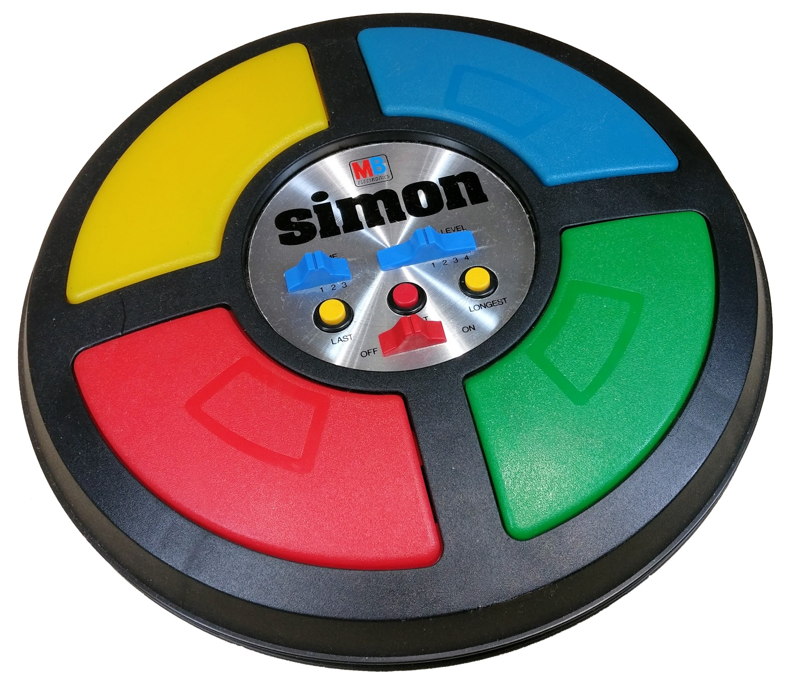
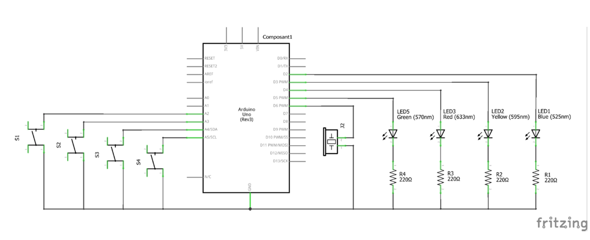
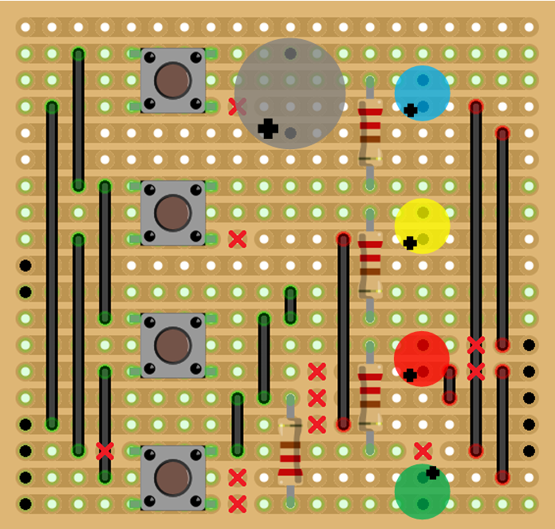
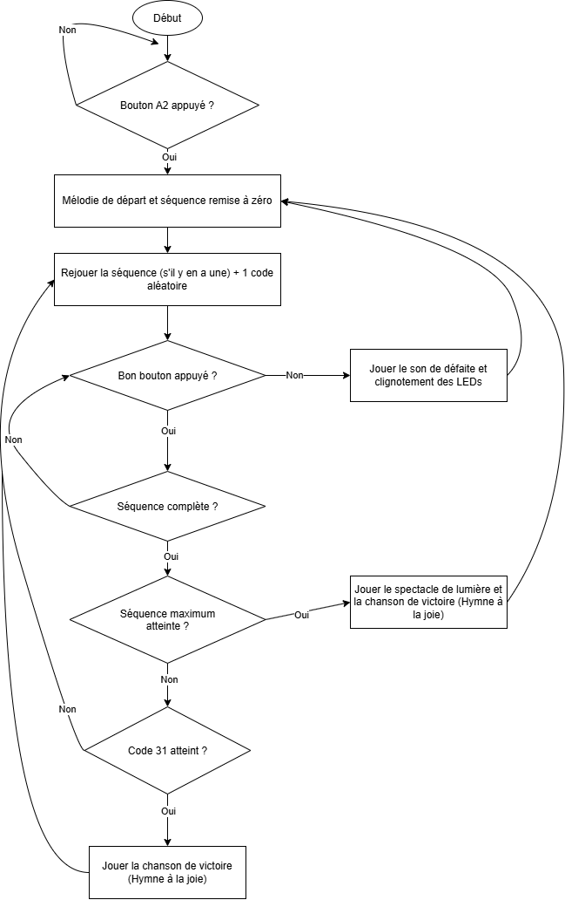

# Projet Simon - Documentation

## 1. Introduction
Ce projet consiste à réaliser le jeu Simon sur un Arduino Uno, à l'aide d'un shield veroboard monté et soudé, puis le programmer en C++ (fichier `ProjEmb_Simon.ino`)

Le jeu Simon est un jeu de mémoire où le joueur doit reproduire une séquence de couleurs en appuyant sur les boutons correspondants. Chaque couleur est associée à une LED et à un son spécifique.

Le jeu commence par un seul code et à chaque fois que l'utilisateur réussit, le code suivant est ajoutée, ce qui rend le jeu progressivement plus complexe à mesure que le joueur réussit à reproduire les codes.

## 2. Schéma électrique
Le shield veroboard relie quatre LEDs, quatre boutons et un buzzer à l'Arduino Uno. Tous les composants partagent la masse (GND) de l'Arduino.

| Composant | Broche Arduino | Rôle | Son associé
|------------|----------------|------|----------------|
| LED Bleue | D2 | Produit la lumière bleue | Mi3 (330 Hz) |
| LED Jaune | D3 | Produit la lumière jaune | Do3 (262 Hz) |
| LED rouge | D4 | Produit la lumière rouge | La2 (220 Hz) |
| LED verte | D5 | Produit la lumière verte | Mi2 (164 Hz) |
| Buzzer | D6 | Produit le son associé à chaque LED | - |
| 4 Résistance 220 Ω | - | Limite le courant pour les LEDs | - |
| Bouton 1 | A2 | Gère la LED bleue et le début de jeu | - |
| Bouton 2 | A3 | Gère la LED jaune | - |
| Bouton 3 | A4 | Gère la LED rouge | - |
| Bouton 4 | A5 | Gère la LED verte | - |

**LEDs**: Chaque LED est branchée entre une sortie numérique (D2 à D5) et la masse, en série avec une résistance de 220 Ω pour limiter le courant.

**Boutons**: Chaque bouton relie une entrée analogique (A2 à A5), utilisée ici comme entrée numérique, à la masse. Il n'y a pas de résistance externe car l'Arduino Uno possède des résistances de pull-up internes qui sont activées dans le code. L'entrée lit donc HIGH lorsque le bouton n'est pas appuyé et LOW lorsqu'il est appuyé.

**Buzzer**: Le buzzer est relié à la broche D6 et à la masse. Il produit le son associé à chaque LED.

**Broche A0**: La broche A0 est utilisée pour générer un nombre aléatoire grâce au bruit électrique lu sur cette broche. Cela permet de créer des séquences de couleurs différentes à chaque partie.

### 2.1 Schéma d'implantation

## 3. Stratégie de réalisation
Pour créer le jeu, j'ai découpé le programme en deux fichiers différents :
1. Le fichier `ProjEmb_Simon.ino` qui contient le code principal du jeu.
2. Le fichier `variables.h` qui contient les définitions des variables utilisées dans le fichier principal.

J'ai aussi utilisé pas mal de fonctions pour rendre le code plus lisible et pour ne pas me répéter. 

### 3.1 Fonction :
| Fonction | Rôle |
|----------|------|
| `void setup()` | Initialise les broches et les variables du jeu. |
| `void loop()` | Contient les boucles principales du jeu, qui gère la séquence et les entrées utilisateur. |
| `void show_note(combination)` | Allume une LED et joue la note associée selon le code. |
| `void play_melody(music)` | Joue soit la mélodie de début, soit celle de victoire. (Hymne à la joie) |
| `void defeat()` | Joue le son de défaite et fait clignoter les leds 4 fois. |
| `void victory()` | Joue un spectacle de lumière et la mélodie de victoire. |

### 3.2 Choix techniques:
- **Utilisation de la bibliothèque Bounce2** pour gérer le rebond des bouttons et donc éviter que le programme croit qu'un bouton a été appuyé plusieurs fois alors qu'il n'a été appuyé qu'une seule fois.
- **Mélodies en mémoire Flash(PROGMEM)**. L'Arduino Uno n'a que 2 Ko de RAM. Les mélodies sont donc stockées en Flash et lues avec pgm_read_word_near(). 

    *Veuillez noter que cette stratégie et ma fonction `play_melody` ce sont inspirées de [cette page github](https://github.com/robsoncouto/arduino-songs/blob/master/furelise/furelise.ino)*
- **Code aléatoire**. Le code de couleurs est générée aléatoirement grâce au bruit lu sur la broche A0 (`randomSeed(analogRead(A0))`).
- **Deux victoires possibles**. Le jeu contient une victoire normale après 31 codes réussies (l'utilisateur continue de jouer) et une victoire spéciale après avoir réussi le nombre maximum de codes (maximum qui est défini par la variable `MAX_COMBINATIONS` dans le fichier `variables.h`). 

    Cette deuxième victoire est pour éviter le crash si l'utilisateur dépasse le nombre maximum de codes du tableau `combinations[]`.

## 4. Diagramme de flux

## 5. Conclusion
Ce projet m'a permis de mettre en pratique mes connaissances en programmation C++. Au début, les exercices étaient un peu difficiles et ennuyeux mais au fur et à mesure que j'ai progressé, j'ai compris le but de ces exercices et je trouve qu'ils ont été utiles pour la réalisation de ce projet.

Créer la veroboard était vraiment sympa vu que nous l'avons fait de zéro. Cela m’a permis d’appliquer ce que je savais en soudure et en électronique. Même si j'ai dû faire un peu de debug à cause d'erreurs de soudure.

J'ai réussi à atteindre tous les objectifs demandés dans le cahier des charges. J'ai même ajouté une deuxième victoire pour éviter le crash du programme si l'utilisateur dépasse le nombre maximum de codes.

Je n'ai pas rajouter d'autres fonctionnalités dû à un manque de temps mais j'aurais aimé rajouter ces fonctionnalités :

1. Ajouter **une accélération de la séquence** à chaque fois que l'utilisateur réussit un code.
2. Ajouter **un temps limite** pour répondre, comme dans le vrai jeu Simon.

Ces fonctionnalités auraient rendu le jeu plus difficile et plus intéressant. Mais je suis satisfait du résultat final et je suis fier de ce que j'ai accompli.

